<div align="center">



<br>


<br><br>

[`INSTALACIÓN`](#instalación) · [`USO`](#uso) · [`MÓDULOS`](#módulos) · [`INFORMES`](#informes) · [`OPCIONES`](#opciones) · [`DISCLAIMER`](#disclaimer)

</div>

---

## Qué es rd-check

**rd-check** es una herramienta de línea de comandos para que los **administradores de sistemas** obtengan, en pocos minutos, **visibilidad sobre los puntos débiles** de sus sitios web y subdominios.

Antes de atacar, un adversario hace **reconocimiento**: averigua qué protecciones tienes, qué software usas, dónde está tu login y si puede llegar a tu servidor sin pasar por el WAF. **rd-check automatiza ese mismo reconocimiento para el defensor**, de modo que tú encuentras las debilidades y las corriges antes de que otra persona las aproveche.

Detrás de rd-check está el equipo de **Report Defense LTDA**: la lógica de cada módulo nace de nuestra experiencia en **pentesting y ejercicios de Red Team**, y el desarrollo se ha apoyado en **agentes de IA** para acelerar la programación, las pruebas y la documentación. Todo el código ha sido **revisado y validado por el equipo** antes de su publicación.
<br>
<br>
<div align="center">



<sub><code>POC sobre example.com</code></sub>

</div>

---

## Cómo te adelanta al atacante

<div align="center">



</div>

---

## Disclaimer

> [!CAUTION]
> **Usa rd-check únicamente sobre dominios que sean tuyos o para los que tengas autorización expresa y por escrito de su propietario.**
>
> Algunos módulos son **activos**: envían patrones de inyección inofensivos (XSS, SQLi, path traversal), cabeceras `Host` manipuladas y, si se solicita, ráfagas de peticiones. Contra sistemas ajenos esto puede activar alarmas, provocar bloqueos o considerarse un intento de intrusión según la legislación de cada país.
>
> rd-check se publica **exclusivamente con fines educativos y defensivos, para ayudar a la comunidad**. **Report Defense LTDA no se hace responsable del uso que terceros hagan de esta herramienta**, ni de daños, bloqueos o consecuencias legales derivadas de un uso indebido. Quien la ejecuta es el único responsable de sus actos.

> [!TIP]
> ¿Solo quieres observar? El modo `--passive` desactiva todas las pruebas activas.

---

## Instalación

```bash
git clone https://github.com/reportdefense/rd-check.git
cd rd-check
python3 -m venv venv && source venv/bin/activate
pip install -r requirements.txt
python3 rd-check.py
```

> [!NOTE]
> En Windows, activa el entorno virtual con `venv\Scripts\activate` en lugar de `source venv/bin/activate`.

| Componente | Requerido | Para qué |
|:--|:--:|:--|
| Python 3.9+ | **sí** | Ejecución |
| `requests`, `urllib3` | **sí** | Peticiones HTTP y pruebas de bajo nivel |
| `selenium` + Chrome/Chromium | opcional | Renderizar JavaScript para detectar captchas y anti-bot dinámicos |

> [!NOTE]
> Sin Selenium o sin Chrome, rd-check sigue funcionando en modo `solo requests` y lo indica al arrancar.

---

## Uso

```bash
# ── objetivo único ─────────────────────────────────────────────
python3 rd-check.py example.com

# ── lista de dominios / subdominios (uno por línea, # = comentario)
python3 rd-check.py -f subdominios.txt

# ── solo observación, sin pruebas activas ──────────────────────
python3 rd-check.py example.com --passive

# ── confirmar rate limiting real con 30 peticiones en ráfaga ───
python3 rd-check.py example.com --burst 30

# ── ¿se puede saltar el CDN/WAF atacando el origen? ────────────
python3 rd-check.py example.com --origin 203.0.113.10

# ── informe en inglés con todos los formatos ───────────────────
python3 rd-check.py example.com --lang en --json --html --sarif

# ── ayuda completa ─────────────────────────────────────────────
python3 rd-check.py -h
```

---

## Módulos

Cada módulo responde a una pregunta que un atacante se hace durante el reconocimiento.

| ID | Módulo | Pregunta del atacante | Modo | Severidad máx. |
|:--:|:--|:--|:--:|:--:|
| `01` | [Rate limiting](#01--rate-limiting) | ¿Puedo probar miles de contraseñas sin que me frenen? | `ACTIVO`* | `ALTA` |
| `02` | [Captcha](#02--captcha) | ¿Mis bots pueden usar los formularios? | `PASIVO` | `ALTA` |
| `03` | [Anti-bot](#03--protección-anti-bot) | ¿Qué solución anti-bot tengo que evadir? | `PASIVO` | `INFO` |
| `04` | [WAF](#04--waf) | ¿Mis inyecciones llegan a la aplicación? | `ACTIVO` | `MEDIA` |
| `05` | [Login y rutas de auth](#05--login-y-rutas-de-autenticación) | ¿Dónde está la puerta y qué endpoints olvidaron? | `PASIVO` | `ALTA` |
| `06` | [Host header](#06--host-header-injection) | ¿Puedo envenenar enlaces de reset o la caché? | `ACTIVO` | `ALTA` |
| `07` | [IP directa y origen](#07--ip-directa-y-bypass-del-origen) | ¿Puedo saltarme el WAF yendo a la IP real? | `ACTIVO` | `ALTA` |
| `08` | [HTTPS](#08--https-y-redirección) | ¿Puedo leer el tráfico en una red compartida? | `ACTIVO` | `MEDIA` |
| `09` | [TLS y certificado](#09--tls-y-certificado) | ¿Puedo degradar el cifrado? | `PASIVO` | `ALTA` |
| `10` | [Cabeceras de seguridad](#10--cabeceras-de-seguridad) | ¿El navegador protege a sus usuarios? | `PASIVO` | `MEDIA` |
| `11` | [Banners y versiones](#11--banners-y-versiones) | ¿Qué versión tienen y qué CVE le aplican? | `PASIVO` | `MEDIA` |
| `12` | [Métodos HTTP](#12--métodos-http) | ¿Hay métodos peligrosos habilitados? | `ACTIVO` | `MEDIA` |
| `13` | [Reverse proxy / CDN](#13--reverse-proxy-y-cdn) | ¿Qué capas hay delante de la aplicación? | `PASIVO` | `INFO` |
| `14` | [DNS e infraestructura](#14--dns-e-infraestructura) | ¿Qué proveedores y servicios usa la organización? | `PASIVO` | `INFO` |
| `15` | [SPF y DMARC](#15--spf-y-dmarc) | ¿Puedo enviar correos suplantando su dominio? | `PASIVO` | `MEDIA` |
| `16` | [IP compartida](#16--ip-compartida) | ¿Hay un vecino más débil en el mismo servidor? | `PASIVO` | `INFO` |

<sub>* Sin <code>--burst</code>, el módulo 01 solo observa cabeceras y respuestas 429 (pasivo). Los módulos <code>ACTIVO</code> se desactivan con <code>--passive</code>.</sub>

---

### `01` · Rate limiting

<details open>
<summary><b>Fuerza bruta, credential stuffing y enumeración de usuarios</b></summary>
<br>

| | |
|:--|:--|
| **Qué analiza** | Cabeceras `X-RateLimit-*`, `RateLimit-*` y `Retry-After`, respuestas HTTP 429 y, con `--burst N`, N peticiones concurrentes (sobre el login si existe) para ver si el servidor llega a frenar. |
| **Por qué importa** | Sin límite de peticiones, un atacante prueba miles de contraseñas por minuto, reutiliza credenciales filtradas o satura el servicio. |
| **Qué te revela** | Si tu login aguanta un ataque automatizado o si necesitas limitar intentos por IP o usuario, bloqueos temporales o captcha progresivo. |
| **Ventaja defensiva** | El atacante descubre la falta de límite mientras ataca; tú lo descubres en una prueba controlada y lo corriges antes. |

</details>

### `02` · Captcha

<details>
<summary><b>La barrera entre humanos y bots</b></summary>
<br>

| | |
|:--|:--|
| **Qué analiza** | reCAPTCHA, hCaptcha, Cloudflare Turnstile, Arkose/FunCaptcha, GeeTest, FriendlyCaptcha, MTCaptcha, AWS WAF Captcha y menciones genéricas, en la home y en las páginas de login. |
| **Por qué importa** | Un formulario de login o registro sin captcha y sin rate limit es el objetivo ideal para la automatización. |
| **Qué te revela** | Qué formularios críticos están protegidos y cuáles no, para priorizar dónde añadirlo. |
| **Ventaja defensiva** | Los bots buscan precisamente los formularios sin captcha; rd-check te los señala primero. |

</details>

### `03` · Protección anti-bot

<details>
<summary><b>Scraping, automatización y creación masiva de cuentas</b></summary>
<br>

| | |
|:--|:--|
| **Qué analiza** | Scripts y cookies de Cloudflare Bot Management, Akamai Bot Manager, Imperva/Incapsula, DataDome, PerimeterX/HUMAN, Kasada, F5 Shape y AWS WAF. |
| **Por qué importa** | Estas soluciones frenan el scraping, la compra automatizada, el robo de credenciales y la creación masiva de cuentas. |
| **Qué te revela** | Si tienes protección anti-bot activa y con qué proveedor, o si el sitio está abierto a la automatización. |
| **Ventaja defensiva** | El atacante identifica el anti-bot para escoger cómo evadirlo; tú confirmas que existe y que cubre las rutas sensibles. |

</details>

### `04` · WAF

<details>
<summary><b>Tener un CDN delante no es lo mismo que tener un WAF que bloquea</b></summary>
<br>

| | |
|:--|:--|
| **Qué analiza** | Identifica el WAF/CDN por cabeceras, cookies y `Server`. Después envía una **petición de control** y tres **patrones de prueba inofensivos** (XSS, SQLi, path traversal) y compara: si bloquea los patrones y deja pasar la petición normal, el WAF filtra de verdad. Intenta identificar quién bloqueó (Cloudflare, ModSecurity, Imunify360, Wordfence, Sucuri, F5 ASM, Fortinet, Barracuda…). |
| **Por qué importa** | Muchas organizaciones creen estar protegidas porque usan un CDN, pero si las reglas no están activas los ataques llegan intactos a la aplicación. |
| **Qué te revela** | Qué tipos de ataque se filtran y cuáles no, y qué proveedor está actuando. |
| **Ventaja defensiva** | Es exactamente la prueba que hace un atacante antes de lanzar inyecciones. Si pasan, activas las reglas antes de que él lo aproveche. |

</details>

### `05` · Login y rutas de autenticación

<details>
<summary><b>La puerta principal y los endpoints olvidados</b></summary>
<br>

| | |
|:--|:--|
| **Qué analiza** | Localiza páginas de login (ES/EN), formularios con contraseña, a qué URL y con qué método se envían las credenciales, captcha, rate limit e indicios de MFA/2FA. Extrae rutas de autenticación del JavaScript y avisa si el login vive en otro subdominio. |
| **Por qué importa** | El login es el primer objetivo de la fuerza bruta. Las rutas que solo aparecen en el JavaScript (APIs, paneles) suelen estar menos protegidas que el formulario visible. |
| **Qué te revela** | Un inventario de tus puntos de autenticación y de cuáles carecen de captcha, límite de intentos o MFA. |
| **Ventaja defensiva** | Los atacantes leen tu JavaScript buscando endpoints olvidados; rd-check lo hace por ti. |

</details>

### `06` · Host header injection

<details>
<summary><b>Enlaces de restablecimiento envenenados y cache poisoning</b></summary>
<br>

| | |
|:--|:--|
| **Qué analiza** | Envía una cabecera `Host` falsa y una `X-Forwarded-Host` falsa y comprueba si la aplicación las refleja en el HTML o en redirecciones. |
| **Por qué importa** | Si la aplicación confía en el `Host` del cliente, un atacante puede hacer que el correo de restablecimiento de contraseña apunte a su dominio, envenenar la caché o forzar redirecciones. |
| **Qué te revela** | Si debes fijar los hosts permitidos (`ALLOWED_HOSTS`, `server_name`, vhost por defecto que rechace hosts desconocidos). |
| **Ventaja defensiva** | Es una vulnerabilidad invisible navegando con normalidad; rd-check la prueba de forma explícita. |

</details>

### `07` · IP directa y bypass del origen

<details>
<summary><b>Toda la protección del CDN anulada en una petición</b></summary>
<br>

| | |
|:--|:--|
| **Qué analiza** | Accede al sitio usando la IP en lugar del dominio y, con `--origin IP`, comprueba si el servidor real detrás del CDN/WAF responde directamente desde Internet. |
| **Por qué importa** | Si el origen acepta conexiones de cualquiera, el atacante **se salta el WAF y el CDN por completo** atacando la IP real. |
| **Qué te revela** | Si debes restringir el origen para que solo acepte tráfico del CDN/WAF (firewall, *authenticated origin pulls*, túnel). |
| **Ventaja defensiva** | Encontrar la IP de origen es de lo primero que intenta un atacante frente a un sitio protegido por un CDN. |

</details>

### `08` · HTTPS y redirección

<details>
<summary><b>Tráfico sin cifrar en redes compartidas</b></summary>
<br>

| | |
|:--|:--|
| **Qué analiza** | Si el puerto 80 redirige a HTTPS o sirve el sitio sin cifrar. |
| **Por qué importa** | Un sitio accesible por HTTP permite interceptar o modificar credenciales y cookies de sesión en redes como las Wi-Fi públicas. |
| **Qué te revela** | Si necesitas forzar la redirección a HTTPS y activar HSTS. |
| **Ventaja defensiva** | Evitas que alguien en la misma red que tus usuarios pueda leer o alterar lo que envían. |

</details>

### `09` · TLS y certificado

<details>
<summary><b>Certificados caducados y protocolos obsoletos</b></summary>
<br>

| | |
|:--|:--|
| **Qué analiza** | Validez del certificado, emisor y caducidad (aviso si quedan menos de 21 días), versión de TLS negociada y si el servidor **todavía acepta TLS 1.0 / 1.1**. |
| **Por qué importa** | Un certificado caducado rompe la confianza y la disponibilidad; los protocolos antiguos tienen debilidades conocidas y están prohibidos por normas como PCI-DSS. |
| **Qué te revela** | Cuándo renovar y qué protocolos desactivar en el servidor. |
| **Ventaja defensiva** | Cierras la puerta a ataques de degradación de protocolo antes de una auditoría externa o de un incidente. |

</details>

### `10` · Cabeceras de seguridad

<details>
<summary><b>Defensa barata y eficaz en el navegador</b></summary>
<br>

| | |
|:--|:--|
| **Qué analiza** | `Strict-Transport-Security`, `Content-Security-Policy`, `X-Content-Type-Options`, `Referrer-Policy`, `Permissions-Policy` y `X-Frame-Options`, más cabeceras obsoletas (`X-XSS-Protection`, `Public-Key-Pins`, `Expect-CT`). |
| **Por qué importa** | Indican al navegador cómo proteger a tus usuarios frente a XSS, clickjacking, rebaja a HTTP o fuga de información. |
| **Qué te revela** | Una puntuación `x/6` y la lista exacta de cabeceras que faltan. |
| **Ventaja defensiva** | Reduces el impacto de una vulnerabilidad de la aplicación incluso antes de que alguien la encuentre. |

</details>

### `11` · Banners y versiones

<details>
<summary><b>No le regales al atacante la búsqueda de CVE</b></summary>
<br>

| | |
|:--|:--|
| **Qué analiza** | `Server`, `X-Powered-By`, `X-AspNet-Version`, `X-Generator`, `<meta name="generator">` y firmas en páginas de error (Apache, nginx, IIS, Tomcat…). |
| **Por qué importa** | Con el software y su versión exacta, al atacante le basta con buscar vulnerabilidades públicas para esa versión. |
| **Qué te revela** | Qué ocultar (`server_tokens off`, `ServerTokens Prod`, quitar `X-Powered-By`) y qué componentes actualizar. |
| **Ventaja defensiva** | Ves la misma información que ve el atacante y la eliminas antes de que la use. |

</details>

### `12` · Métodos HTTP

<details>
<summary><b>OPTIONS, TRACE y DEBUG</b></summary>
<br>

| | |
|:--|:--|
| **Qué analiza** | Métodos declarados con `OPTIONS` y si `TRACE` o `DEBUG` están habilitados. |
| **Por qué importa** | `PUT` o `DELETE` sin control pueden permitir subir o borrar archivos; `TRACE` permite *Cross-Site Tracing*; `DEBUG` es típico de entornos .NET mal configurados. |
| **Qué te revela** | Qué métodos desactivar en el servidor web. |
| **Ventaja defensiva** | Cierras funciones que nadie usa pero que un atacante sí probaría. |

</details>

### `13` · Reverse proxy y CDN

<details>
<summary><b>El mapa real de lo que hay delante de tu aplicación</b></summary>
<br>

| | |
|:--|:--|
| **Qué analiza** | Proxies, balanceadores y CDN (Cloudflare, CloudFront, Akamai, Fastly, Varnish, Envoy, Kong, Vercel, Netlify, GitHub Pages…) por sus cabeceras, y respuestas que vienen de servidores distintos. |
| **Por qué importa** | Conocer la arquitectura real indica dónde aplicar cada control y descubre capas inesperadas o mal configuradas. |
| **Qué te revela** | Las capas que atraviesa cada petición hasta tu aplicación. |
| **Ventaja defensiva** | El atacante dibuja este mapa para buscar el eslabón débil; tú lo tienes primero. |

</details>

### `14` · DNS e infraestructura

<details>
<summary><b>La información pública que se consulta primero</b></summary>
<br>

| | |
|:--|:--|
| **Qué analiza** | Registros A, AAAA, NS, MX y TXT (cliente DNS propio, `1.1.1.1` por defecto), ASN, prefijo y país de cada IP (Team Cymru), propietario del rango (RDAP), proveedores de correo según el SPF y servicios verificados en los TXT (Google, Microsoft 365, Atlassian, Stripe…). |
| **Por qué importa** | Revela hosting, correo y servicios SaaS que usa la organización: vectores típicos de phishing dirigido e ingeniería social. |
| **Qué te revela** | Qué información expones y si hay registros TXT antiguos o de servicios que ya no usas. |
| **Ventaja defensiva** | Ves tu organización tal como la ve quien prepara un ataque dirigido. |

</details>

### `15` · SPF y DMARC

<details>
<summary><b>Suplantación de tu dominio por correo</b></summary>
<br>

| | |
|:--|:--|
| **Qué analiza** | Existencia de SPF y DMARC, y si la política DMARC es `p=none` (solo monitoriza, no protege). |
| **Por qué importa** | Sin SPF y DMARC en `quarantine` o `reject`, cualquiera puede enviar correos haciéndose pasar por tu dominio: base del fraude BEC, facturas falsas y phishing a clientes. |
| **Qué te revela** | Si debes configurar SPF y endurecer DMARC de forma progresiva. |
| **Ventaja defensiva** | Impides que usen tu marca para engañar a tus clientes y empleados. |

</details>

### `16` · IP compartida

<details>
<summary><b>Tu seguridad también depende de tus vecinos</b></summary>
<br>

| | |
|:--|:--|
| **Qué analiza** | Otros dominios alojados en la misma IP (si la IP no pertenece a un CDN). |
| **Por qué importa** | En un hosting compartido, un sitio vulnerable en el mismo servidor puede ser la puerta de entrada al tuyo. |
| **Qué te revela** | Si conviene un alojamiento aislado para los servicios críticos. |
| **Ventaja defensiva** | Los atacantes usan esta técnica para encontrar un objetivo más fácil en tu servidor. |

</details>

---

## Informes

| Formato | Se genera | Uso típico |
|:--|:--:|:--|
| Consola | siempre | Veredictos, DNS y resumen ejecutivo por dominio |
| Markdown `.md` | siempre | Informe completo con evidencias y comandos `curl` |
| CSV `.csv` | siempre | Excel o filtrado de muchos dominios |
| JSON `.json` | `--json` | Integraciones y base para `--baseline` |
| HTML `.html` | `--html` | Resumen visual para compartir |
| SARIF `.sarif` | `--sarif` | Plataformas de CI/CD y *code scanning* |

Con un dominio los informes se guardan en el directorio actual; con `-f` se crea la carpeta `rd-check_<lista>_<fecha>`.
> [!NOTE]
> rd-check muestra los resultados en **español** por defecto, pero también puede generarlos en **inglés**: añade `--lang en` y tanto la salida en consola como los informes (Markdown, CSV, JSON, HTML y SARIF) se crearán en inglés. La ayuda también está disponible en ambos idiomas con `--help --lang en`.

### Seguimiento continuo y CI/CD

```bash
# Comparar con un análisis anterior: muestra qué controles han cambiado
python3 rd-check.py -f subdominios.txt --json --baseline anterior/informe.json

# Hacer fallar un pipeline si aparecen hallazgos ALTA
python3 rd-check.py example.com --passive --fail-on high
```

| Código de salida | Significado |
|:--:|:--|
| `0` | Análisis completado sin superar el umbral de `--fail-on` |
| `1` | No se obtuvo ningún resultado |
| `2` | Hallazgos por encima del umbral de `--fail-on`, o argumentos inválidos |

---

## Opciones

Todas estas opciones aparecen explicadas al ejecutar `python3 rd-check.py --help` (o `--help --lang en` para verlas en inglés).

<details>
<summary><b>Objetivo</b></summary>
<br>

| Opción | Descripción |
|:--|:--|
| `DOMINIO` | Dominio o URL a analizar |
| `-f, --file FICHERO` | Lista de dominios, uno por línea ('-' = stdin) |

</details>

<details>
<summary><b>Pruebas</b></summary>
<br>

| Opción | Descripción |
|:--|:--|
| `--passive` | Solo observación: sin pruebas WAF, Host header, métodos, ráfaga ni origen |
| `--burst N` | Ráfaga de N peticiones para confirmar el rate limit (máx. 200) |
| `--origin IP` | IPv4 del servidor de origen: comprueba si se salta el CDN/WAF |
| `--no-selenium` | No renderizar con Chrome headless |
| `--render-wait SEG` | Espera tras renderizar con Selenium (def. 2) |
| `--verify-tls` | Verificar certificados en las peticiones HTTP |
| `--deny-private` | Omitir objetivos con IP privada, loopback o metadatos cloud |

</details>

<details>
<summary><b>Rendimiento</b></summary>
<br>

| Opción | Descripción |
|:--|:--|
| `-t, --threads N` | Dominios en paralelo (1-32, def. 3) |
| `--timeout SEG` | Tiempo máximo por petición (def. 10) |
| `--max-rps N` | Límite de peticiones por segundo (0 = sin límite) |
| `--retries N` | Reintentos ante 502/503/504 (0-5, def. 1) |

</details>

<details>
<summary><b>DNS</b></summary>
<br>

| Opción | Descripción |
|:--|:--|
| `--no-dns` | Omitir todo el análisis DNS |
| `--no-rdap` | No consultar RDAP (propietario del rango IP) |
| `--no-asn` | No consultar ASN (Team Cymru) |
| `--no-shared-ip` | No buscar otros dominios en la misma IP |
| `--resolver IP` | Servidor DNS (def. 1.1.1.1) |
| `--dns-timeout SEG` | Tiempo máximo por consulta DNS (def. 3) |

</details>

<details>
<summary><b>Informes</b></summary>
<br>

| Opción | Descripción |
|:--|:--|
| `-o, --output NOMBRE` | Nombre del informe o de la carpeta de salida |
| `--json` | Generar también JSON |
| `--html` | Generar también HTML |
| `--sarif` | Generar también SARIF |
| `--baseline JSON` | Comparar con un informe JSON anterior |
| `--fail-on {never,medium,high}` | Salir con código 2 si hay hallazgos de esa severidad (CI/CD) |
| `--lang {es,en}` | Idioma de la salida (def. es) |

</details>

<details>
<summary><b>Otros</b></summary>
<br>

| Opción | Descripción |
|:--|:--|
| `-q, --quiet` | Salida mínima en consola |
| `--no-color` | Desactivar colores (también NO_COLOR) |
| `--debug` | Registrar cada petición |
| `-h, --help` | Mostrar la ayuda completa |
| `-V, --version` | Mostrar la versión |

</details>

---

## Privacidad y servicios externos

Para enriquecer el análisis, rd-check consulta servicios públicos que **reciben la IP o el dominio analizado**:

| Servicio | Dato que aporta | Desactivar con |
|:--|:--|:--|
| Resolver DNS (`1.1.1.1`) | Registros DNS | `--resolver IP` · `--no-dns` |
| Team Cymru | ASN y prefijo de red | `--no-asn` |
| rdap.org | Propietario del rango IP | `--no-rdap` |
| HackerTarget | Dominios en la misma IP | `--no-shared-ip` |

> [!IMPORTANT]
> Si auditas sistemas de clientes con requisitos de confidencialidad, desactiva los servicios que no debas usar.

---

## Buenas prácticas

- [x] Empieza con `--passive` y pasa a las pruebas activas solo con autorización.
- [x] Avisa a operaciones o al proveedor del WAF antes de lanzar `--burst`, para que no lo confundan con un ataque real.
- [x] Usa `--max-rps` en entornos de producción sensibles.
- [x] Recuerda que `NO` en rate limit sin `--burst` significa **sin cabeceras visibles**, no ausencia confirmada.
- [x] Verifica a mano los hallazgos `ALTA` y `MEDIA` con los comandos `curl` del informe antes de actuar.

---

<div align="center">

<br>

<a href="https://www.reportdefense.com"></a>

<a href="https://www.reportdefense.com"><b>www.reportdefense.com</b></a>

<br>

**rd-check** es una herramienta desarrollada por el equipo de **Report Defense LTDA** y compartida con la comunidad<br>para ayudar a los administradores de sistemas a obtener visibilidad rápida de sus puntos débiles.

<br>

<sub>SÍGUENOS</sub>

<a href="https://youtube.com/@reportdefense"></a>
<a href="https://instagram.com/reportdefense"></a>
<a href="https://linkedin.com/company/reportdefense-it"></a>

<br>

<sub><code>Uso exclusivamente defensivo y educativo · Report Defense LTDA no se responsabiliza del uso indebido</code></sub>

</div>
